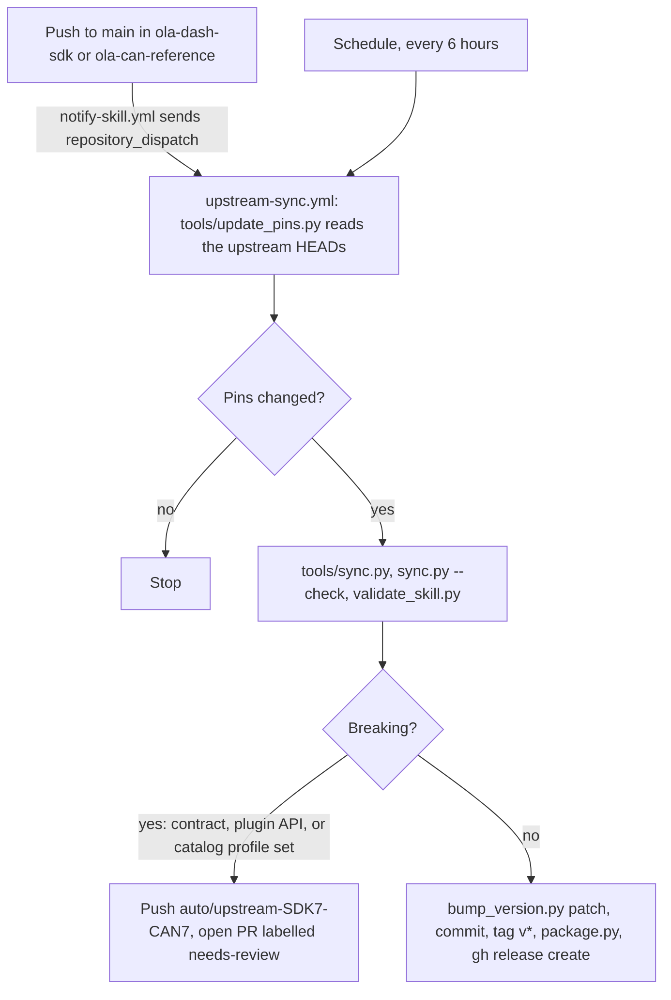

# Ola Dev Skill

An [Agent Skill](https://agentskills.io) that teaches an AI coding agent to build apps, themes, widget plugins, and read-only analysis tools for the **Ola S1 Pro Gen 1** electric scooter dash. It works with Claude Code, OpenAI Codex, Gemini CLI, Cursor, and any agent that can read a folder of instructions.

Skill version: <!-- skill-version -->0.2.0<!-- /skill-version -->. See [CHANGELOG.md](CHANGELOG.md).

It packages what two public projects have learned:

- [Ola Dash SDK](https://github.com/abhi245y/ola-dash-sdk) (GPL-3.0-or-later): a Slint dash platform with runtime themes, plugin API v1, a theme contract, and a clean-room vehicle-parser interface.
- [Ola CAN Reference](https://github.com/abhi245y/ola-can-reference) (MIT): a catalog of CAN IDs, signals, and enums for Gen 1 firmware HVDP 5.0.0.

## What an agent can build with it

- **Themes** for the dash: layout, colour, fonts, and motion, rendered in a desktop preview before anything touches a scooter.
- **Widget plugins** that show a value card on the dash.
- **Navigation and media plugins** that feed turn-by-turn or now-playing data.
- **Ride-log and CAN analysis tools** that read captures and explain them, with confidence labels.
- **Contract extensions**, following the SDK's additive rules.

Display-only, with one exception the SDK defines: a theme may ask the host to open the trunk (`Actions.open-trunk()`), and the host sends the stock command only when the scooter is unlocked, in Park, stopped, and the latch is known closed. The skill refuses code that adds any other vehicle command, bypasses that gate, starts, moves, unlocks, or controls a vehicle, transmits CAN frames by default, or touches updates. See `skills/ola-scooter-dev/references/safety.md`.

## Install

The skill is one folder, `ola-scooter-dev/`, packaged in each [GitHub Release](https://github.com/abhi245y/ola-dev-skill/releases) with a `SHA256SUMS` file. The installer downloads the newest release, checks its checksum, and unzips it where your agent looks for skills.

```sh
curl -fsSL https://raw.githubusercontent.com/abhi245y/ola-dev-skill/main/install.sh | sh -s -- --agent claude
```

Prefer to read the script first? Download it, look at it, then run it:

```sh
curl -fsSLO https://raw.githubusercontent.com/abhi245y/ola-dev-skill/main/install.sh
less install.sh
sh install.sh --agent claude
```

| Option | Meaning |
|---|---|
| `--agent NAME` | `claude` (default), `codex`, `gemini`, `cursor`, `agents-md`, or `all` |
| `--project DIR` | Install into a project instead of your home folder. Also writes the pointer files for Gemini, Cursor, or AGENTS.md |
| `--version vX.Y.Z` | Install a specific release instead of the latest |
| `--from-file ZIP` | Install a release zip you already downloaded. Its `SHA256SUMS` must sit beside it |
| `--uninstall` | Remove what the installer put in place for the agent |

Where each agent gets the skill:

| Agent | Skill folder | Pointer needed |
|---|---|---|
| Claude Code | `~/.claude/skills/ola-scooter-dev/` (or `.claude/skills/` with `--project`) | No |
| OpenAI Codex | `~/.codex/skills/ola-scooter-dev/` (home folder only) | No |
| Gemini CLI | `~/.local/share/ola-scooter-dev/` (or `.agents/skills/` with `--project`) | Line in `GEMINI.md` |
| Cursor | Same as Gemini CLI | `.cursor/rules/ola-scooter-dev.mdc` |
| AGENTS.md agents | Same as Gemini CLI | Line in `AGENTS.md` |

Without `--project`, the installer prints the pointer line and does not write into any project. Check your agent's documentation for its current skills path, since these change. Set `OLA_SKILL_REPO` to install from a fork.

### Manual install

1. Download `ola-scooter-dev-X.Y.Z.zip` and `SHA256SUMS` from the release page.
2. Check the zip: `sha256sum -c SHA256SUMS` (macOS: `shasum -a 256 -c SHA256SUMS`).
3. Unzip it and copy the `ola-scooter-dev` folder to the path in the table above. On Windows, extract the zip and copy the folder to `%USERPROFILE%\.claude\skills\` for Claude Code. Add a pointer line for other agents by hand.

### Check that it works

Start a new session and ask: **"What Ola skills do you have?"** The agent should name `ola-scooter-dev`. You can also check that `ola-scooter-dev/SKILL.md` exists in the folder from the table.

### Updates and pinning

- Releases are automatic. The skill re-syncs with its upstreams and publishes a new patch release when they change. See [How releases are made](#how-releases-are-made).
- To update, run the same install command again. It prints `up to date` when nothing changed. A changed copy is moved to `~/.local/state/ola-scooter-dev/backups/`, not left beside the new one, so the agent never loads two copies.
- To pin, add `--version v0.1.0`. Breaking upstream changes ship as a new minor or major version after a human review, so a pinned version stays on its contract.
- Uninstall with `--uninstall` and the same `--agent` and `--project` options.

## How to use it

Ask in plain language. Name the output you want and the scooter data it needs.

- "Make me a dash theme with a big speed readout and a dark palette. Preview it in the sim first."
- "Write a widget plugin that shows tyre temperature on the dash."
- "Decode this CAN capture and label what is known and what is not."
- "Which contract fields can a theme read, and which callbacks are allowed?"

The skill tells the agent to say what it verified (rendered, compiled, or seen on a scooter) and what it did not.

## How releases are made



A change is **breaking** when the theme contract version, the plugin API version, or the set of CAN catalog profiles changes. Those need a person to decide the new version (`tools/bump_version.py minor` or `major`) and to merge the PR. Any other change gets a patch release automatically.

`.github/workflows/release.yml` releases a `v*` tag that a person pushes by hand. It checks that the tag matches `skill_version`.

### Maintainer setup

1. **Dispatch token.** Create a fine-grained personal access token owned by `abhi245y`. Set repository access to only `abhi245y/ola-dev-skill`. Under Repository permissions, set **Contents: Read and write** (needed for `repository_dispatch`). Store it as the secret `SKILL_DISPATCH_TOKEN` in **both** `ola-dash-sdk` and `ola-can-reference`. Without it, the 6-hourly schedule still syncs; the upstreams just wait up to six hours.
2. **Upstream notifier.** Copy `upstream-notifier/notify-skill.yml` into each upstream repo as `.github/workflows/notify-skill.yml`, with the matching `EVENT_TYPE` and paths. See `upstream-notifier/README.md`.
3. **Repository settings.** In `ola-dev-skill`, allow GitHub Actions to create pull requests, and let `github-actions[bot]` push to `main` (or exempt it from branch protection). The workflow creates the `needs-review` label itself.
4. **Versions.** Bump by hand only for a MINOR or MAJOR change: `tools/bump_version.py minor`, then commit and tag. Patch bumps are automatic.

## Maintainer checks

```sh
python3 tools/validate_skill.py                 # frontmatter, links, JSON, theme template, version match
python3 tools/update_pins.py --sdk DIR --can DIR   # move the pins to the checkouts' HEADs (writes upstream.json)
python3 tools/sync.py --check                   # generated references match the pinned upstream
python3 tools/package.py --out dist             # release zip and SHA256SUMS
sh -n install.sh                                # installer syntax
```

`tools/sync.py` and `tools/update_pins.py` need both upstream checkouts. Point them at the checkouts with `--sdk` and `--can`, or run `scripts/fetch-upstream.sh` first.

## Pinned upstream versions

| Upstream | Commit | Licence | Version |
|---|---|---|---|
| Ola Dash SDK | `65e2ba8e51f049eb8cb992f9f439d66b830dbff8` | GPL-3.0-or-later | 0.1 experimental, contract v6, plugin API v1 |
| Ola CAN Reference | `b73acee3b9d63f63e4d3303623ebd83b805806c7` | MIT | profile `gen1-hvdp-5.0.0` |

The pins live in `skills/ola-scooter-dev/upstream.json`.

## Fetch the upstream sources

The skill points at the upstream repos at pinned commits. Fetch them once:

```sh
skills/ola-scooter-dev/scripts/fetch-upstream.sh          # pinned commits (default)
skills/ola-scooter-dev/scripts/fetch-upstream.sh --latest # newest, not pinned
```

They land in `~/.cache/ola-scooter-dev/upstream` unless you pass `--dir`.

## Disclaimer

This is an **unofficial, community project**. It is not affiliated with, endorsed by, sponsored by, or supported by Ola Electric. "Ola" and "S1" are trademarks of Ola Electric, used only to describe compatibility.

- Use it only on a scooter you own.
- Installing a custom dash may affect your warranty or the scooter's behaviour. You accept that risk.
- The upstream software is experimental and has been tested on one scooter. Treat its output as information, not as a safety system. Do not rely on a custom dash for warnings. The scooter's own indicators are the reference.
- Do not use the dash for anything beyond glanceable information while riding.
- The authors provide this without warranty. See `LICENSE`.

## Licence

MIT. See [LICENSE](LICENSE). The skill's references describe GPL-3.0-or-later and MIT upstream projects. The skill does not copy their code, except where a template is written fresh for it.
